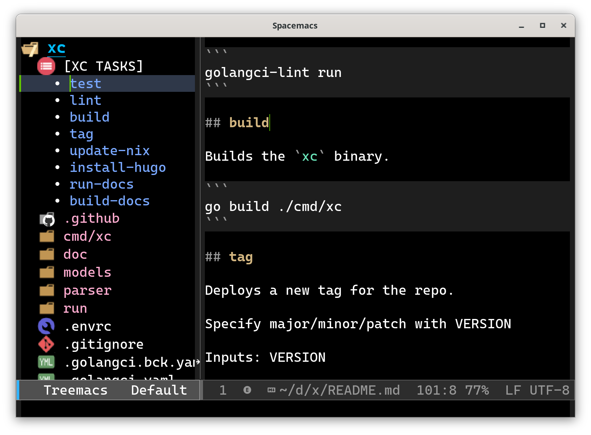

* About

xc.el provides an Emacs interface for [[https://xcfile.dev/][xc]].

** Action shot

#+caption: Emacs screenshot showing a buffer editing README.md with a Treemacs sidebar displaying available XC tasks in a tree.

* To use
** Installation instructions

You can install this package directly from Codeberg like so:

#+begin_src elisp
  (use-package xc
    :vc (:url "https://codeberg.org/ryanprior/xc.el.git" :branch "main"))
#+end_src

If you use Spacemacs, you can add this data to your =dotspacemacs-additional-packages=:

#+begin_src elisp
  (xc :location (recipe :fetcher codeberg
                        :repo "ryanprior/xc.el"))
#+end_src

If you would like to help me get this into GNU Elpa, feel free to bug me.
(Otherwise I will probably get around to it once eventually.)

** Configuration

#+begin_src elisp
  ;; Recommended: bind to keyboard
  (bind-key "C-c x" #'xc)

  ;; If you use Treemacs, initialize the integration:
  (with-eval-after-load 'treemacs
    (xc-treemacs-init))
#+end_src

*** Customization options

**** =xc-executable=

By default, the package will use whatever =xc= is found on your =PATH=. If that's not what you want, customize =xc-executable= to point to the executable you prefer to use. An absolute path is recommended, but a relative path is also permitted, which might be handy i.e. as a directory-local variable.

**** =xc-type=

When invoked, =xc= will use whichever type of README it finds, searching the current directory and then in parents: either =README.md= or =README.org=. In a directory that has both files, it will prefer Markdown. If you want to limit =xc= to use only one type, customize =xc-type= as either "org" or "md".
